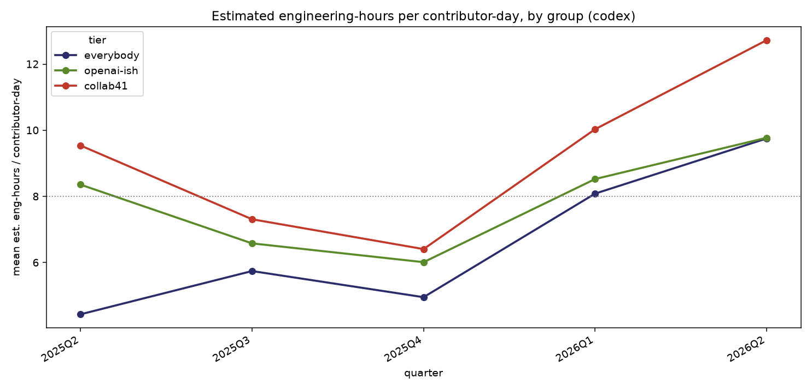
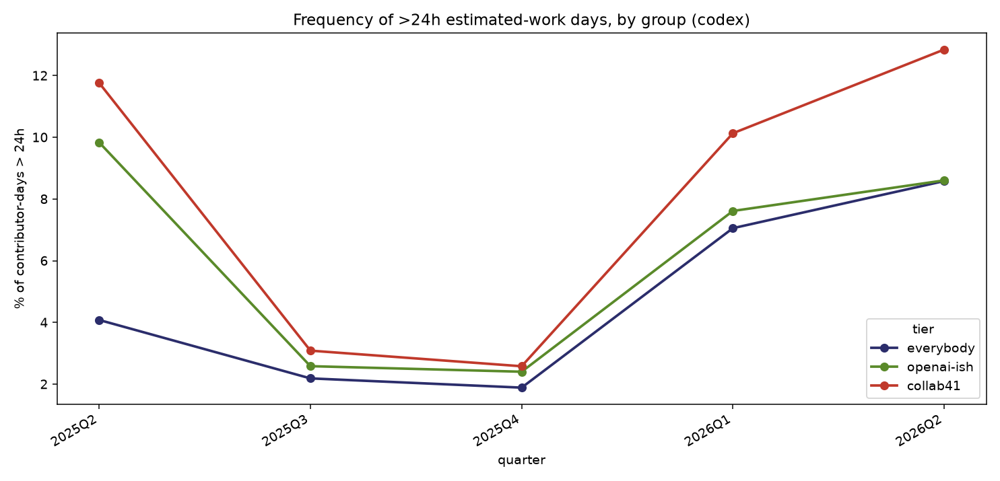
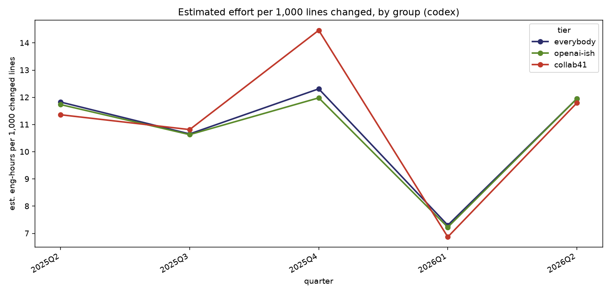
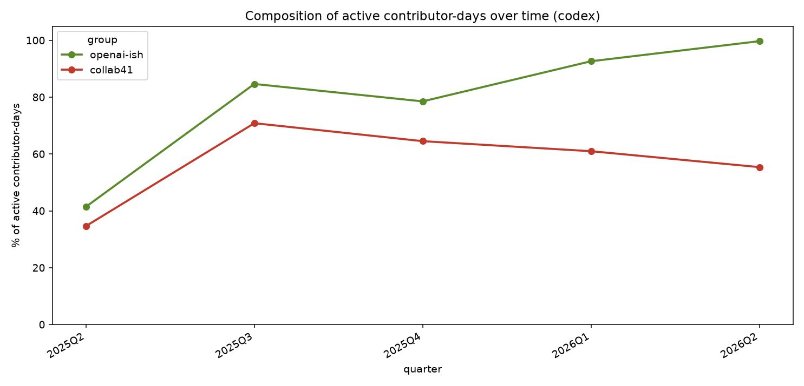

# Estimating engineering effort behind merged PRs in `openai/codex`

*An LLM-judge estimate of human-equivalent engineering hours per merged PR, aggregated into contributor-day metrics.*

## Method

For each of the **7,524 merged PRs** in `openai/codex` (Apr 2025 – Jun 2026), three
models — **Claude Haiku 4.5, GPT-5.4-mini, and Gemini 3 Flash**, each with
reasoning disabled — independently read the PR's title, description, commit
messages, and full net diff, and estimate how many hours **one experienced
engineer, working alone with no AI tools**, would need to produce that exact
change. The per-PR estimate is the **median** of the three models. The judge
prompt is adapted from METR's "time without AI" prompt.

Each PR's hours are then distributed evenly across the distinct **contributor-days**
its work touches — the `(contributor, calendar-day)` pairs on which its **branch
commits** were authored (so a PR worked across three days counts as three
contributor-days, not one). Contributors are canonical GitHub identities; bots are
excluded. We report three groups: **everybody**, **openai-ish** (322
OpenAI-affiliated logins), and **collab41** (the 41-person core).

## Findings

### 1. Estimated effort per contributor-day

Effort per committing day rises across every group into 2026, with the core team
highest — **collab41 reaches ~12.7 human-equivalent hours per contributor-day** in
2026 Q2 (vs an 8-hour reference). But the *overall* ("everybody") line is steeper
than either cohort line and converges up toward them — which is a composition
effect, not a per-person surge (see §4).

| group | 2025 Q2 | 2026 Q2 | factor |
|---|---|---|---|
| everybody | 4.4 | 9.8 | 2.2× |
| openai-ish | 8.4 | 9.8 | 1.2× |
| collab41 | 9.5 | 12.7 | 1.3× |

### 2. How often a contributor-day exceeds 24 hours of estimated work

A contributor-day above 24 human-equivalent hours means more than a full
unassisted-engineer-day of accepted work shipped under one person on one day.
Overall this is **5.8%** of contributor-days; for the core it climbs to **12.8% in
2026 Q2** (every super-day is many real PRs, not one inflated estimate — median 9
PRs per super-day, no bots).

### 3. Effort vs. lines changed

Estimated effort tracks churn closely and stably — roughly **12 judged hours per
1,000 changed lines** across all groups and quarters (the 2026 Q1 dip is a
one-quarter lines bulge). At this aggregate the LLM-effort signal corroborates
lines-of-code rather than diverging from it; the value it adds is an absolute,
human-interpretable unit and the tail behavior in §2, not a different *shape* of trend.

### 4. The overall trend is mostly composition

The share of active contributor-days that are OpenAI-affiliated rose **41% → 100%**.
Early on, most contributor-days were casual/external contributions (~1–1.7 estimated
hours each) that dragged the "everybody" average down; as those faded from the
active mix, the overall average rose toward the (much flatter) insider level. So the
headline ~2.2× overall rise is largely *who is committing changing over time*. The
cleaner within-cohort signal — the fixed 41-person core — rises a modest **~1.3×**,
with an anomalously intense founding quarter (2025 Q2) and a real climb through 2026.

## Bottom line

- The core team now produces **~12–13 human-equivalent engineering hours of accepted
  work per committing day**, and exceeds a full unassisted-day (>24h) on ~1 day in 8.
- The dramatic *overall* rise overstates per-person change: most of it is the active
  contributor base shifting toward high-output insiders. Within a fixed cohort the
  per-day effort increase is real but modest (~1.3×).
- Judged effort and lines-changed move together at the contributor-day aggregate, so
  the contribution of this method is a calibrated absolute scale and the
  extreme-day frequency, not a fundamentally different trend than LoC.

---

*Scale: 7,524 PRs × 3 models, ensembled. Secondary views (total estimated hours per
quarter; distribution of hours per contributor-day) are in `data/codex/plots/`.*
